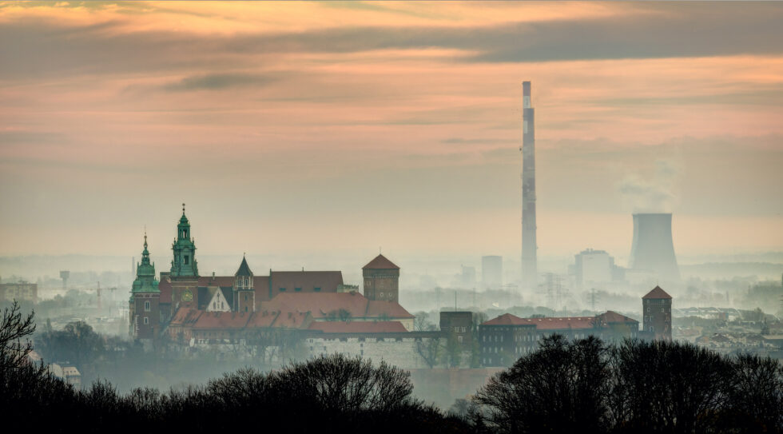

# PM2.5 Concentrations in Polish Cities


<p align="center">
  <a href="https://notesfrompoland.com/2021/01/12/krakow-records-third-worst-air-pollution-in-the-world-as-smog-descends-on-poland/">Krakow Smog</a>
</p>


## Purpose of this Repository
This repository is for the final project for EDS 222: Statistics for Environmental Data Science. The analysis uses statistical modeling to explore how temperature, wind speed, and relative humidity affect PM2.5 concentrations in different cities across Poland.


## Package Dependencies


## File Structure
```
tree
```

## Data Information & Access


## Authors
Author: [Karolina Sienko](https://github.com/karolinasienko)

Contributors: 


## Citations
